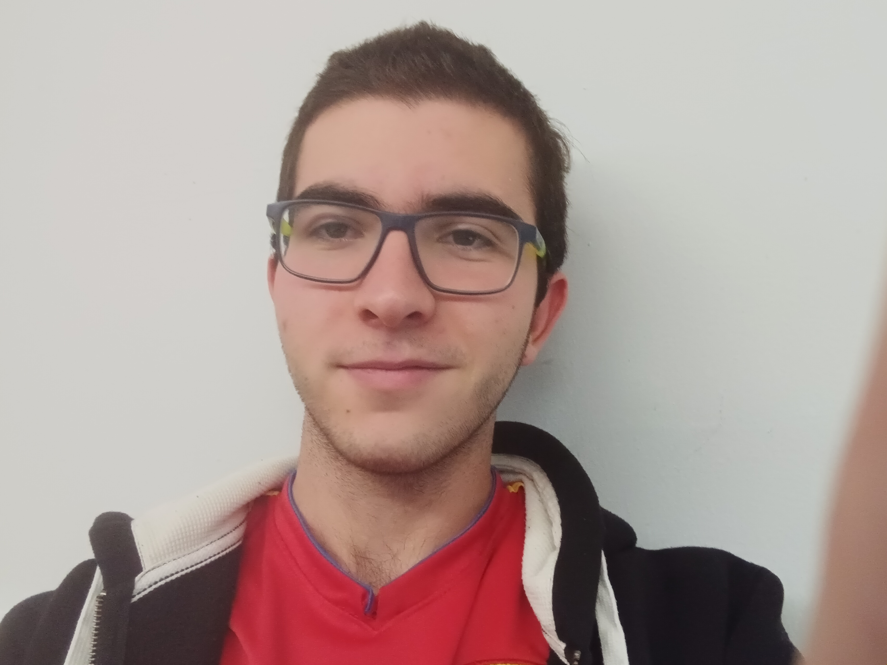

Autor

Hola, me llamo Enzo Robledo, tengo 17 años, nací en "España", en el "Prat de Llobregat", soy una persona que tiene depresión desde pequeño pero aun así me vuelvo a levantar y encuentro la forma de seguir adelante, actualmente estoy estudiando en el instituto "les salines" un ciclo formativo de "informatica y redes locales", y tambien estoy haciendo "atletismo" en el club del "pratenc".

Este soy yo
